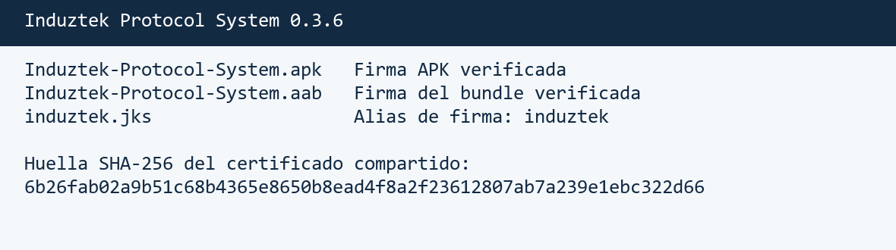

# Induztek Protocol System

**DSY1105 · Evaluación Parcial 4**

**Integrante:** Sebastián Navarrete ([Sebanava](https://github.com/Sebanava))

## Contexto y funcionalidades

Induztek Ingeniería realiza pruebas eléctricas en terreno. Registrar en papel y transcribir más tarde demora la entrega al cliente y dificulta comparar mediciones. La app permite registrar instalaciones, equipos, visitas y pruebas, guardar mediciones e historial, formalizar protocolos y consultar informes según el perfil autorizado.

Android usa Kotlin, Jetpack Compose, Room, Retrofit y WorkManager. La captura local continúa durante cortes de conectividad. La sincronización envía cambios al API Gateway, que enruta hacia Identidad, Protocolos y Bitácora mediante Eureka. Cada servicio Spring Boot utiliza un esquema MySQL propio.

## APIs

| Servicio | Métodos y rutas |
| --- | --- |
| Identidad | POST /api/sesiones, GET /api/sesion, POST /api/mi-contrasena, POST /api/recuperacion/solicitar, POST /api/recuperacion/confirmar, GET /api/usuarios, POST /api/personal, POST /api/clientes |
| Protocolos | GET /api/registros, POST /api/sincronizacion |
| Bitácora | GET y POST /api/bitacora |
| Nager.Date | GET https://nagerholidays.com/api/v4/Holidays/CL/{año} |

En **Visitas y actas → Ver visita y acta → Consultar feriado nacional**, Android consulta el año de la visita por HTTPS. La app muestra el feriado nacional informado por Nager.Date o el estado de la consulta. Si falla la conexión, se puede reintentar y continuar trabajando con la visita. La solicitud envía el país y el año.

OpenAPI de los servicios propios se encuentra en `http://127.0.0.1:8080/{servicio}/v3/api-docs`, con `identidad`, `protocolos` o `bitacora` como servicio.

## Ejecución local

1. Instala JDK 21, MySQL 8 y Android Studio con Android SDK 35.
2. Descarga el [repositorio de microservicios](https://github.com/Sebanava/induztek-protocol-system-microservicios). Ejecuta `mysql/crear-esquemas.sql` en MySQL y crea un usuario con permisos sobre cada esquema respectivo.
3. En terminales separadas, inicia `eureka`, `identidad`, `protocolos`, `bitacora` y `gateway` mediante `gradlew.bat :<modulo>:bootRun` desde la raíz del backend. En Identidad, Protocolos y Bitácora define `DB_URL`, `DB_USER` y `DB_PASSWORD` para el servicio correspondiente. Los puertos predeterminados son 8761, 8081, 8082, 8083 y 8080, respectivamente.
4. Abre la raíz de este proyecto Android en Android Studio. Ejecuta el módulo `app` en el emulador. Desde **Conexión y sincronización** usa `http://10.0.2.2:8080/`. En un dispositivo físico configura una URL HTTPS accesible para el Gateway.
5. Para comprobar el flujo, entra como técnico y registra una medición en una visita. Sincroniza el protocolo, revísalo como ingeniera y consulta el informe con la cuenta cliente correspondiente. La recuperación de contraseña en un entorno real necesita SMTP en Identidad.

## Pruebas y distribución

- Android: `gradlew.bat :app:testDebugUnitTest :app:coberturaLogicaDebug`. La versión 0.3.6 pasó 43 pruebas de Android. JaCoCo midió 820 de 1003 líneas (81,76 %) en dominio, repositorio, ViewModel y calendario. El informe se genera en `app/build/reports/jacoco/coberturaLogicaDebug`.
- Backend: `gradlew.bat test jacocoTestReport`.
- Firma release: configura `INDUZTEK_KEYSTORE` con la ruta al JKS y `INDUZTEK_STORE_PASSWORD` de forma local. Ejecuta `gradlew.bat :app:assembleRelease :app:bundleRelease`.
- El APK y el AAB se generan en `app/build/outputs/apk/release` y `app/build/outputs/bundle/release`. El JKS se entrega en el paquete privado de distribución.

### Evidencia de firma

La verificación de la versión 0.3.6 confirmó que el APK, el AAB y el alias `induztek` del JKS comparten el certificado con huella SHA-256 `6b26fab02a9b51c68b4365e8650b8ead4f8a2f23612807ab7a239e1ebc322d66`.

[Captura del calendario en el emulador](evidencias/calendario-emulador.png)

### Trabajo e historial

El proyecto tiene un único integrante declarado. Los repositorios públicos contienen el historial técnico de Android y de los microservicios. La modalidad individual y la acreditación de Trello están pendientes de confirmación académica.